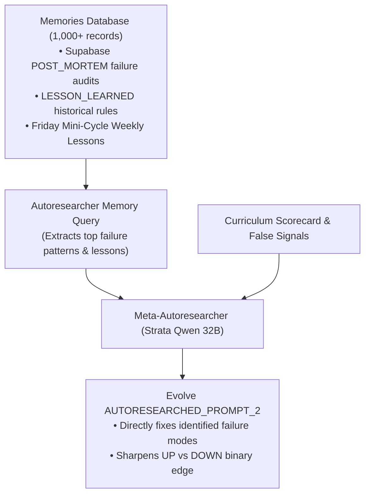

# Strata Two-Pass Double-Ratchet & Model Distillation

The **Strata Two-Pass Double-Ratchet** is a co-evolutionary prompt optimization architecture running 100% locally on dedicated hardware via **Qwen 32B (Strata)** (`http://localhost:8080/v1`).

---

## Architectural Pivot: Retiring Laya for Pure Qwen Reasoning

Early iterations of the double-ratchet pipeline paired Qwen 32B (Step 1 Ingestion) with **Laya** (`ModernBERT-large`, 395M parameters) as a Step 2 classification head. Empirical evaluation across curriculum passes revealed critical limitations with Laya:
1. **Lack of Chain-of-Thought (CoT)**: As a 395M bidirectional encoder, Laya evaluates cross-attention in a single forward pass without step-by-step reasoning or intermediate deduction.
2. **Structural Bull Bias (82%+ `UP`)**: In bull-market regimes (2024–2026) where futures are green >68% of mornings, ModernBERT's attention weights latched onto optimistic lexical surface tokens ("beat", "rally", "growth"), predicting `UP` 82% of the time. When market structure broke down into sharp drawdowns, it lacked the analytical capacity to weigh contradictory macro evidence and suffered extended losing streaks.
3. **Decoupled Two-Pass Qwen Architecture**: The pipeline replaces Laya by running **Qwen 32B for both passes**, maintaining unconstrained reasoning for high-conviction directional intelligence.

---

## Two Autoresearched Prompts & Pipeline Flow

The tournament co-evolves two distinct, tightly-coupled prompts:

```text
┌────────────────────────────────────────────────────────────────────────┐
│                        MODEL 1: CATALYST GENERATOR                     │
│                                                                        │
│   Raw Pre-Market Feeds (Newsletters, Tape, FRED Yields, Options)       │
│   + AUTORESEARCHED_PROMPT_1 (Ingestion & Distillation Prompt)          │
│                                   │                                    │
│                                   ▼ (Re-generated on every mutation)   │
│             High-Density Daily Catalyst Briefing (~200–240 words)      │
│             (Macro/Yields, Multi-Day Tape, Options, Catalysts)         │
└───────────────────────────────────┬────────────────────────────────────┘
                                    │
                                    ▼
┌────────────────────────────────────────────────────────────────────────┐
│                        MODEL 2: PREDICTION ARBITER                     │
│                                                                        │
│   Catalyst Briefing (from Model 1)                                     │
│   + Point-in-Time Historical Memories (< target_date)                  │
│   + AUTORESEARCHED_PROMPT_2 (Predictive Arbiter & Decision Rules)      │
│                                   │                                    │
│                                   ▼                                    │
│                  Qwen 32B via Strata (:8080)                           │
│                  (Native <think> Reasoning: Budget = -1)               │
│                                   │                                    │
│                                   ▼                                    │
│   Structured JSON: {direction: UP|DOWN, confidence: float,            │
│                     rationale: string}                                 │
└────────────────────────────────────────────────────────────────────────┘
```

### Model 1: Catalyst Ingestion (`AUTORESEARCHED_PROMPT_1`)
- **Input**: Raw uncompressed morning observations timestamped $\le 09:15\text{ AM ET}$ (full cleaned financial newsletters, overnight quotes, FRED yield curve prints, options positioning, rolling 5-day momentum vector, and point-in-time memories).
- **Zero Caching & Live Ingestion**: The briefing is **re-generated fresh and live from raw newsletters for every session day**. No pre-cached briefings are re-used, ensuring Model 1 authentically reads and processes institutional newsletters and market context on every run.
- **Output**: Objective catalyst briefing (~200–240 words) structuring macro yields, multi-day tape, options skew, and conflicting catalyst tensions.

### Model 2: Predictive Decision Arbiter (`AUTORESEARCHED_PROMPT_2`)
- **Input**: The dense catalyst briefing synthesized by Model 1 **plus** point-in-time historical memories from `cached_memories` created strictly before the target date.
- **Reasoning**: Qwen executes native chain-of-thought reasoning (`<think>...</think>`), weighing the catalyst brief and past lessons to resolve directional tension.
- **Zero Abstention Contract (MANDATORY)**: Every single trading session the model **must choose either `UP` or `DOWN`**. There is **no minimum confidence threshold (`min_confidence`), no confidence gating, and no `NO_TRADE`**.
- **Deterministic Fallback Arbitration**: When market conditions present conflicting evidence, Prompt 2 applies explicit fallback rules referencing Section 5:
  - *If full UP not met*: Use Section 5 dominant signal favoring trend continuation over mean-reversion.
  - *If full DOWN not met*: Use Section 5 dominant signal favoring bearish positioning or yield divergence.
- **Output**: Pure structured JSON committing to binary direction:
  ```json
  {
    "direction": "DOWN",
    "confidence": 65.0,
    "probabilities": {"UP": 0.35, "DOWN": 0.65},
    "rationale": "Overnight gap up (+0.28%) unconfirmed by tech breadth; 10Y yields spiked 5 bps and 5D tape shows parabolic exhaustion."
  }
  ```

---

## Memory-Driven Autoresearch: How Prompt 2 Queries Memories

To improve `AUTORESEARCHED_PROMPT_2`, the Meta-Autoresearcher loop does not guess blind—it actively queries the **Supabase / SQLite memories database**:



1. **Active Database Query**:
   - Before synthesizing a new Prompt 2 mutation, the Autoresearcher queries the database for high-importance `POST_MORTEM` records and `LESSON_LEARNED` entries (including the accumulated Friday mini-cycle lessons).
2. **Failure Mode Diagnosis**:
   - The memories and recent false-signal diagnoses are injected directly into Strata's mutation prompt.
   - Strata evaluates why prior decisions failed (e.g. *fading unconfirmed gap-ups*, *trend persistence misjudgments*) and updates `AUTORESEARCHED_PROMPT_2`'s criteria to systematically eliminate those error modes while preserving binary direction commitments.
3. **Point-in-Time Contract**:
   - During day $T$ simulation, Model 2 is restricted to memories created strictly prior to $T$ (`WHERE created_at < target_date`), preventing lookahead bias.

---

## Curriculum Batches & Stashed 10% Test Protocol

To prevent overfitting and guarantee true out-of-sample evaluation:

1. **10% Sequestered Stashed Test Set**:
   - 10% of all eligible calendar weeks (~11 complete calendar weeks) are deterministically partitioned into a persistent, held-out test set (`stashed_weeks`).
   - Autoresearch tournaments and baseline training passes **never see or train on any stashed test weeks**.
2. **Randomized Curriculum Batches per Run**:
   - The remaining 90% of weeks (~96 weeks) serve as the active training pool.
   - For each run or iteration, a batch of weeks (e.g. 5 or 10 weeks) is **sampled randomly** across the active pool, preventing the autoresearch loop from memorizing a static sequence of dates.
3. **Weekly Friday Mini-Autoresearch Cycles**:
   - At each week's Friday close (16:00 ET), a local mini-cycle reviews the week's daily predictions against actual close direction.
   - Strata generates 1–2 dense, actionable tactical lessons.
   - Appends lessons to local SQLite `cached_memories` timestamped at Friday 20:00 UTC (`{friday}T20:00:00Z`), explicitly categorized as `memory_type: LOCAL_AUTORESEARCH_LESSON` and prefixed with `[Local Autoresearch]`.
   - Subsequent weeks query these newly compounded lessons point-in-time (`WHERE created_at < target_date`).
4. **Post-Autoresearch Out-of-Sample Test Evaluation**:
   - Upon completion of all tournament iterations, the champion prompt pair is automatically evaluated against the untouched **10% stashed test weeks** to establish an honest out-of-sample benchmark.

---

## Dedicated 3B Student Model Fine-Tuning Roadmap

While Qwen 32B serves as the teacher and primary reasoning engine during autoresearch, executing two 32B passes per day in live production carries hardware overhead.

### The Distillation Strategy
1. **Teacher Dataset Generation**:
   - The two-pass Qwen 32B tournament generates a high-quality dataset of paired examples across hundreds of historical sessions:
     - `Input`: High-density daily briefing (~240 words) + point-in-time trend/memory vector.
     - `CoT Target`: Qwen 32B's successful reasoning trajectories (`<think>...</think>`).
     - `Label`: Verified winning binary directional calls (`UP`, `DOWN`) with empirical close confirmation.
2. **Student Model Fine-Tuning (3B Parameters)**:
   - Fine-tune a lightweight 3B parameter model (e.g. `Qwen2.5-3B-Instruct` or `Llama-3.2-3B` using LoRA/QLoRA).
   - The 3B student model is trained specifically on **Pass 2 (Prediction)**: consuming the teacher's dense briefing and reproducing calibrated, high-conviction directional decisions.
3. **Deployment Benefits**:
   - **Low Latency**: 3B inference executes in sub-second timeframes (~300ms vs ~120s for 32B).
   - **VRAM Economy**: A 3B model in 4-bit (Q4_K_M) takes only ~2.2 GB of VRAM, easily co-existing alongside other local background agents on consumer GPUs (e.g. RTX 3060).
   - **Zero Lookahead**: The student is trained exclusively on point-in-time historical data.

---

## Unconstrained Reasoning Budget & 16k Token Capacity

> [!IMPORTANT]
> **Hard Requirement**: Qwen's thinking budget must NEVER be artificially capped or throttled during distillation or decision passes (`STRATA_REASONING_BUDGET_TOKENS = -1`).
> Client request payloads must allocate at least 16,384 output tokens (`STRATA_MAX_TOKENS = 16384`) with up to 3 local retries and progressive backoff.
> During meta-autoresearch and failure audit evaluation, Qwen 32B typically generates 3,500 to 7,000 tokens of intermediate `<think>` chain-of-thought before emitting structured JSON; artificially low limits (e.g., 3,000 tokens) result in null payload truncation errors.

---

## Zero External Cloud API Calls & Local SQLite Isolation (MANDATORY)

> [!CAUTION]
> All inference for Pass 1 (Ingestion), Pass 2 (Prediction), and Weekly Mini-Cycles must run **100% locally on dedicated hardware** (Strata on port 8080).
> Zero calls to external cloud LLM APIs (Anthropic, OpenAI, OpenRouter Jev).
> All tournament state, mini-cycle lessons (`memory_type: 'LOCAL_AUTORESEARCH_LESSON'`), and synthesized prompt mutations remain strictly in local SQLite (`.local_autoresearch_cache.db`), resulting in **0 writes to Supabase**.

---

## Related
- [[entities/local-autoresearch]] — Local prompt tournament orchestrator
- [[concepts/laya-decisions-model]] — Legacy ModernBERT decision classifier (deprecated)
- [[entities/daily-market-predictor]] — Morning arena predicting intraday SPY direction
- [[concepts/pure-directional-scoring]] — Directional scoring metric
